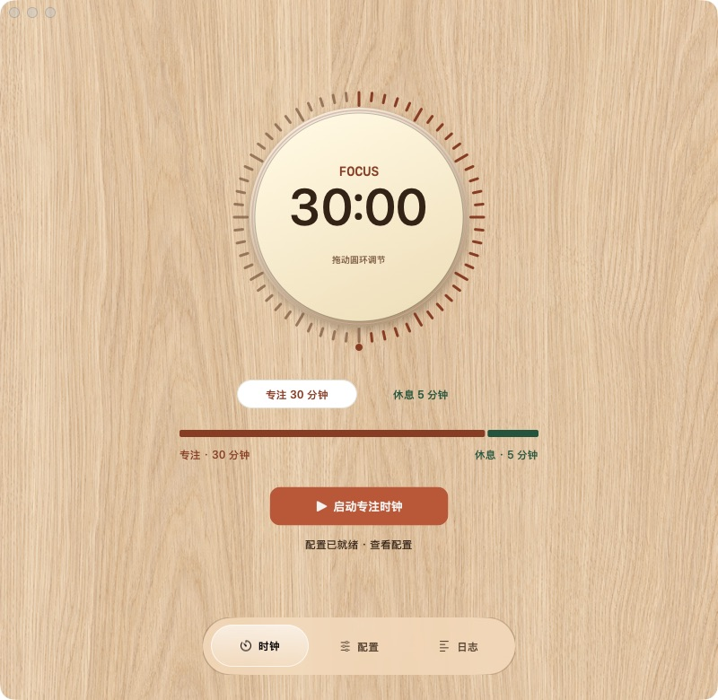
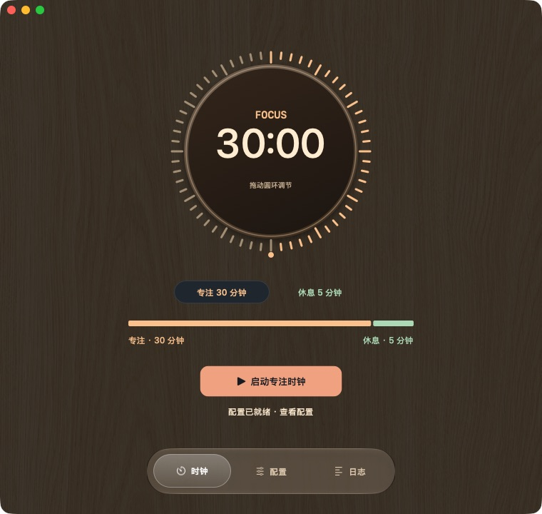
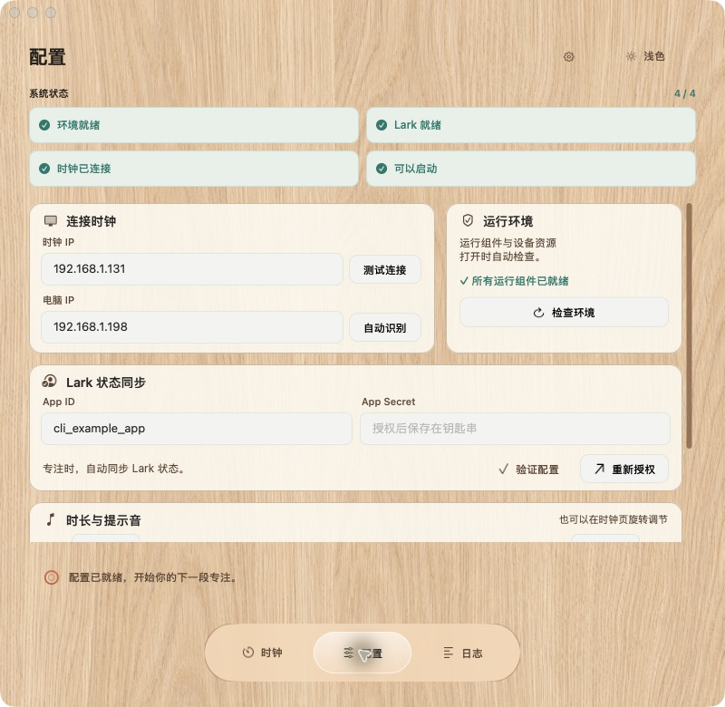
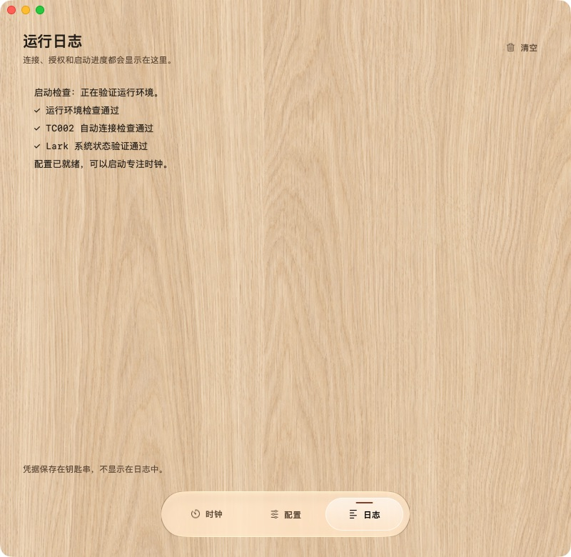

# Ulanzi TC002 Focus Companion（macOS GUI）

这是统一入口的原生 macOS 前端。底部悬浮导航提供“时钟 / 配置 / 日志”三个页面：日常启动留在时钟页，首次配置与排查各自独立。

1. 检查 Node.js、ADB、EMQX 和设备运行包；
2. 填写时钟 IP，自动识别电脑 IP，并可单独测试 ADB 连接；
3. 填写 Lark App ID 和 App Secret，完成授权后可单独验证系统状态权限；
4. 设置专注/休息分钟数，点击“启动专注时钟”；
5. 应用自动安装/启动本机 EMQX、Lark bridge、MQTT adapter，写入设备时长，
   并把临时 Focus bundle 推到 `/tmp`；
6. 点击“恢复原生界面”会重启时钟。重启只清掉临时程序，不刷写固件。

界面会显示环境、Lark、TC002 和后台服务的独立就绪状态。OAuth 输出会实时出现在日志区，启动时会按 1/5–5/5 显示当前进度。启动前先检查 TC002 端口和 ADB 连接；设备未连通时不会安装或重载电脑端服务。GUI 会自行管理一条专用 ADB 连接，关闭 GUI 时结束该连接。

时钟页只保留居中的大尺寸旋钮、专注／休息切换、节奏时长条和启动入口，无需滚动。配置页集中放置系统状态、IP、运行环境、Lark、时长输入与 MP3；四项系统状态固定在顶部，滚动配置时仍可确认验证结果。日志独立显示。底部悬浮导航始终可见。配置与日志的滚动条只绘制细长滑块，不显示轨道底色或边框，木纹可从轨道位置透出；保留原生拖动、点击、辅助功能及覆盖式渐隐行为，显示方式仍响应 macOS 滚动条设置。刻度盘与节奏条是配置预览，不代表设备实时倒计时。

时钟页可以直接调节时长：先点击圆环下方“专注 / 休息”选择调节项，再沿圆环拖动。顺时针增加、逆时针减少，一圈为 60 分钟，范围为 1–240 分钟；从当前时长开始调整，跨圈不会跳回起点。也支持滚轮和方向键（Shift + 方向键每次 5 分钟），配置页输入框与节奏条同步更新。调节结果用于下一次启动，不会中断设备正在进行的计时。

界面默认跟随 macOS 外观，点击配置页右上角的外观按钮，可选择“跟随系统 / 浅色 / 深色”。时钟、配置与日志统一使用无边框的满铺木纹，不添加外圈倒角或背板投影；日志正文背景透明，输入框保留稳定底色，次要文字使用暖色不透明墨色以保持可读性。表盘保留暖白盘面与铜色边缘；深咖色数字和铜棕／深绿刻度增强可读性。深色模式使用深木盘面、暖象牙数字和明亮刻度。每项系统状态同时提供图标和文字。

使用支持的 SDK 构建时，macOS 26+ 的悬浮导航直接采用 Apple 原生 `NSGlassEffectView`，呈现真实 Liquid Glass 的折射、高光与悬浮阴影；macOS 27+ 使用支持的 SDK 构建时启用原生交互响应。木纹延伸到导航下面，选中项使用薄的半透明填充，不叠加第二层玻璃。macOS 13–15 或旧 SDK 构建自动回退为兼容磨砂材质，不冒充原生 Liquid Glass。窗口默认 800×780，可缩放到 760×720；专注与休息时长限制为 1–240 分钟。设计参考 [Apple Liquid Glass](https://developer.apple.com/videos/play/wwdc2025/219/)；木纹生成提示词见 [材质说明](Assets/README.md)。

导航共用一个滑动的半透明选中层：点击会平滑移动，横向拖动会跟随鼠标并轻微拉伸，松手吸附到最近页面。向上／下拖离导航、按 Escape 或窗口失焦会取消拖动；导航获得焦点后可用左右方向键切换。鼠标操作不显示蓝色焦点框，键盘操作时使用短的暖色标记提示焦点，不移除键盘访问能力。“减少动态效果”开启时停止滑动动画和拉伸，直接拖动仍可用。该交互同时适用于原生液态玻璃和兼容材质。自绘选中层响应“减少透明度”和“增加对比度”，辅助功能选项改变后即时刷新。

配置页按用户指定的分组，为连接时钟、运行环境、Lark 状态同步、时长与提示音各提供轻薄的暖色圆角底框和细描边；不添加整个页面的外框，不增加分组高度，也不叠加玻璃材质。浅色底框为暖象牙色，深色为深木棕；开启“减少透明度”时使用不透明填充，开启“增加对比度”时加强描边。输入框和四项就绪状态保留有意义的控件边界；系统状态仍固定可见。日志页不加装饰外框，标题与配置页统一。木纹上的文字和连续比例节奏条使用铜棕／墨绿色，短休息不会因格子取整而消失。设计应用了 [GitHub macOS 原生设计 skill](https://github.com/github/awesome-copilot/tree/main/skills/macos-golden-gate-design) 的克制材质、清晰分组和可读性检查方法；skill 是开发参考，不是安装或运行 App 的依赖。

<p align="center">
  
  
</p>

<p align="center">
  
  
</p>

以上截图来自隔离预览，使用示例配置，不包含真实凭据。

“高级设置”默认折叠，入口收在配置页的齿轮按钮中。项目目录会优先使用 App 内置资源并自动识别源码目录，普通用户无需填写；只有开发者使用自定义检出位置时才需要展开修改。

App 每次打开都会自动检查运行环境；如果时钟 IP 和电脑 IP 已保存，会自动测试 TC002；如果钥匙串中已有完整 Lark 授权，会自动验证系统状态权限。缺少配置的项目保持原状态，不会自动打开 OAuth 或猜测地址。前三项通过后，第 4 格显示绿色“可以启动”，用户只需点击“启动专注时钟”。第二次打开 App 时，正常情况下会自动恢复为四格绿色。

在配置页“时长与提示音”中可以点击“选择 MP3”选择本机 MP3，文件大小限制为 20 MB。自定义文件只保存到当前用户的 App 支持目录，并在下一次点击“启动专注时钟”时覆盖推送到设备的临时音频路径；“恢复默认”会改回内置提示音。不会修改固件或项目文件。

环境检查会识别 Homebrew、`~/.local`、nvm、fnm、Volta 和 mise 等常见 Node.js 安装位置，不依赖 Finder 是否加载终端的 `.zshrc`。如果确实缺少 Node.js、ADB 或 EMQX，界面会说明缺少的组件，并在用户确认后使用 Homebrew 安装。

Lark 自建应用需要先配置回调地址
`http://127.0.0.1:8788/oauth/callback`，并开通、发布系统状态相关 API 权限：获取系统状态、创建系统状态、批量开启和批量关闭。授权按钮会打开浏览器，OAuth 输出会实时显示在日志区；浏览器回调完成后，GUI 会自动关闭本地授权服务并恢复按钮。

Lark App Secret、OAuth token、refresh token 和 bridge shared secret 不写入 GUI
配置文件，仍由现有 bridge 写入 macOS 钥匙串。GUI 配置文件只保存设备 IP、时长、
项目目录。用户 `open_id` 和“专注中”状态 ID 在授权时自动获取。

## 新 Mac 准备

不方便让 Agent 直接执行多次网络下载时，可以让用户在 macOS“终端”运行：

```bash
curl -fsSL --retry 3 https://raw.githubusercontent.com/Pimmpimmm/ulanzi-tc002-focus-clock/main/install-from-github.sh | /bin/bash -s -- --apply
```

这条命令不依赖 Git，默认下载到 `~/ulanzi-tc002-focus-clock`。仓库根目录也提供
`一键准备TC002.command`。它会安装 Homebrew 中缺少的
Node.js、EMQX 和 ADB，执行测试和 bundle 完整性校验，然后构建并打开 App。
Homebrew 和 Apple Command Line Tools 仍需要用户先安装。

bootstrap 完成后显示“待首次启动”是正常的：为了避免在 Lark 凭据和局域网地址
未确认时启动错误服务，LaunchAgent 会延迟到用户完成授权并点击“启动专注时钟”后创建。

## 运行前提

- macOS 13 或更高版本；
- Node.js 24+、Homebrew EMQX、ADB 已安装；
- 时钟已经打开 Wi‑Fi ADB，且和 Mac 在同一个局域网；
- bootstrap 会用 `npm ci` 安装本项目锁定的依赖；
- 首次使用需要在 Lark 开放平台配置 OAuth 回调：
  `http://127.0.0.1:8788/oauth/callback`。

## 授权和环境排障

- Lark 返回 `HTTP 400, code 99991672`：应用缺少系统状态 API 权限。开通权限、发布应用版本并确认租户可用后，再点击“重新授权 Lark”。
- 首次授权未完成或浏览器被关闭：授权进行中时按钮会显示“重新开始授权”。再次点击会结束旧 OAuth 进程、释放本机 `8788` 端口并自动打开新的授权页面，不需要退出 App。
- 浏览器显示授权成功但 GUI 一直显示“正在打开 Lark 授权页面”：这是旧版本地 OAuth 服务没有关闭浏览器 keep-alive 连接。请退出并重新打开最新的 App；凭据已经写入钥匙串，不需要重复填写 Secret。
- GUI 报 Node.js 缺失但终端可以运行：Finder 不加载 `.zshrc`。新版 GUI 会扫描 Homebrew、`~/.local`、nvm、fnm、Volta 和 mise；仍缺少时会询问是否使用 Homebrew 安装。
- TC002 端口不可达：核对时钟屏幕上的当前 IP 和 Wi-Fi ADB，确认 Mac 与时钟位于同一可互访局域网；访客 Wi-Fi、客户端隔离和设备休眠都可能中断连接。建议在路由器中给时钟和 Mac 做 DHCP 地址保留，避免下次换 IP。
- 时钟端口可达，但 GUI 的 ADB 连接失败：在 macOS“系统设置 → 隐私与安全性 → 本地网络”允许 TC002 专注助手访问局域网，退出再打开 App 并点“测试时钟连接”；如安装了网络拦截软件，也检查它是否拦截 `adb`。GUI 使用自己的 ADB 服务端口，所以终端里的 `adb devices` 不一定列出 GUI 连接的设备。macOS 15+ 会单独管理 App 的本地网络权限。
- 本地 OAuth 端口被占用时，先关闭其他一次性授权窗口，再重新授权；端口为 `127.0.0.1:8788`。

项目根目录运行（开发调试）：

```bash
cd mac-app
swift run
```

生成可双击的 `.app`：

```bash
bash mac-app/build-app.sh
open mac-app/dist/TC002FocusCompanion.app
```

界面验收可以使用隔离预览模式，不读取钥匙串、不连接 TC002，也不保存用户配置：

```bash
open -n mac-app/dist/TC002FocusCompanion.app --args --ui-preview
open -n mac-app/dist/TC002FocusCompanion.app --args --ui-preview --preview-dark
open -n mac-app/dist/TC002FocusCompanion.app --args --ui-preview --preview-empty
open -n mac-app/dist/TC002FocusCompanion.app --args --ui-preview --preview-compact
open -n mac-app/dist/TC002FocusCompanion.app --args --ui-preview --preview-legacy-glass
```

构建脚本会用 App 的固定 Bundle ID 签名并校验整个 `.app`；本机默认使用临时签名。有 Apple 开发者签名证书时，可设置 `TC002_CODESIGN_IDENTITY` 再构建，以便在多台 Mac 上长期分发时稳定识别权限。请只启动同一份最新构建的 GUI，避免两个同标识的 App 副本同时运行。

当前构建会把 bridge、companion、已校验的 `TemporaryFocusRelease` 和木纹素材放入
App Resources。木纹显示不需要联网或 imagegen 依赖。构建自动检测 SDK 对 Liquid Glass 的支持，旧 SDK 仍可构建兼容样式。Node 由 bootstrap 在用户电脑安装。正式对外分发前仍需签名和公证。

## 安全边界

- “启动”只临时写 `/tmp/ui`、`/tmp/lib`、`/tmp/EasyUI.cfg` 和设备可写目录中的
  `device.conf`；不写 `/res`，不生成或刷入 `update.img`。
- “恢复原生界面”本质是重启 TC002；设备重启后自然回到原生界面。
- 每个人的 Lark 凭据保存在自己的 Mac 钥匙串，不放在 GitHub 或共享配置文件中。
